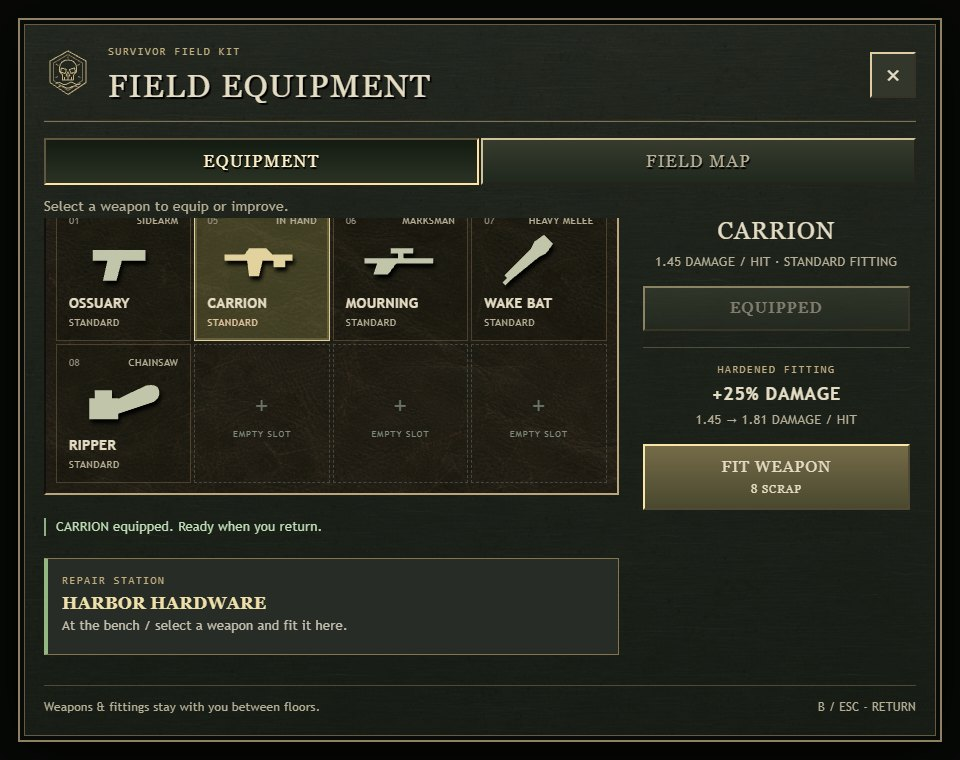
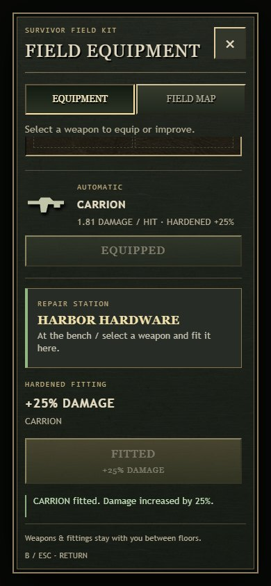
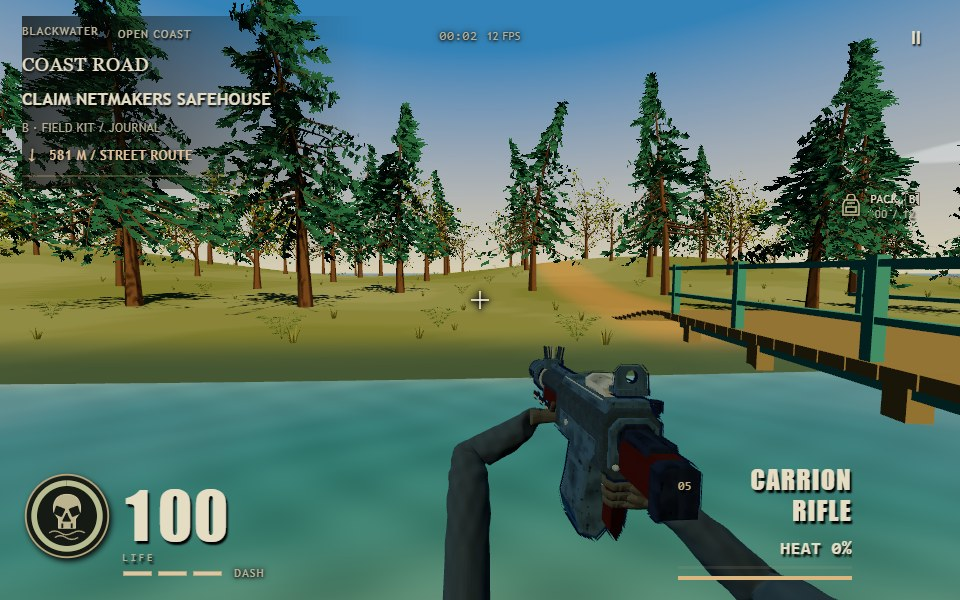
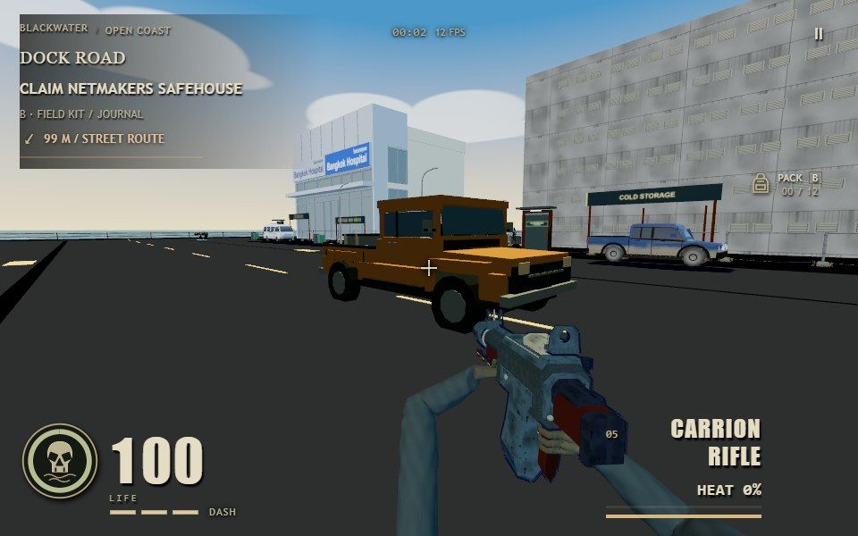
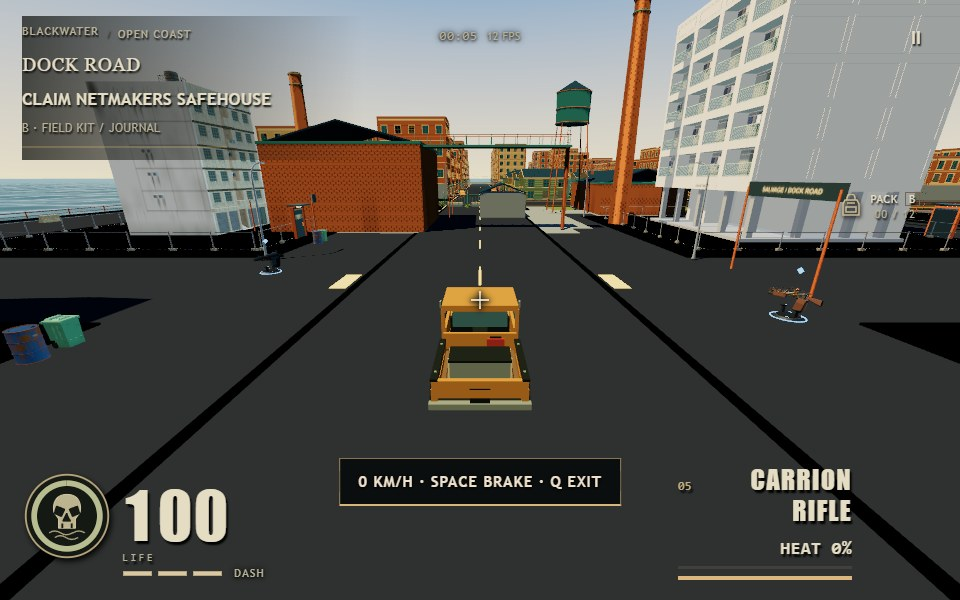
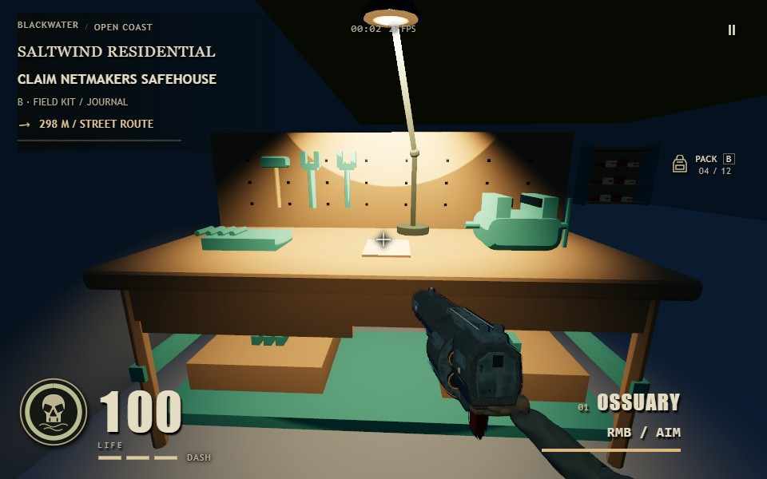
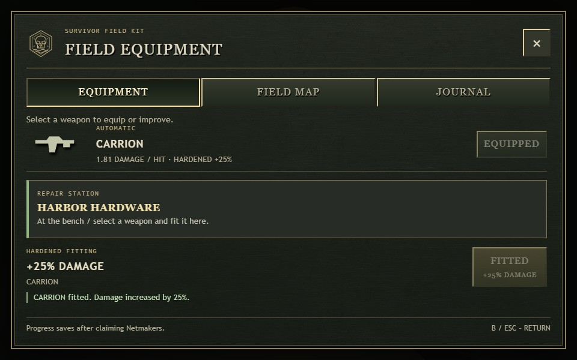

# Blackwater inspection 13

This is a bounded world, furnishing and equipment-loop iteration in the existing graphic-horror direction. The 94 ground-floor interiors and their collision authority remain usable. Upper floors outside the authored Cape cottage remain outside this pass.

The shared furniture compiler now gives repair benches a framed lower shelf, drawer, connected tool board, distinct hammer/wrenches, a two-jaw vise and sorted fittings. Forty-six usable repair stations derive from these same furniture records. The existing hardened fitting still costs eight scrap and grants 25% damage to one owned weapon; coastal fitting now requires reachable bench access, with wall, floor, distance and jump checks. The field kit shows the station and offers a walking destination to Harbor Hardware; approaching a bench produces one contextual B prompt. The existing Saltwind cache was relocated to the actual Hardware tabletop with its saved pickup ID preserved; the total stays at twelve, and all twelve have visible pooled representations. Legacy dungeon fitting and the existing shared-pack rules are preserved.

There are 2,433 seeded grass/fern clumps across building verges (1,300), forest floor (633), river banks (350) and eastern slopes (150). Placement excludes road corridors, both building portals, walking paths and open stream water. Terrain clumps use the exact triangulated height function; verges root on the existing pavement height. Ferns have connected spines down to their roots. Two shared geometry buffers and two painted materials serve 66 spatial instance batches in the actual runtime; camera distance culls them (13 visible at Hardware, 23 at the river inspection view). Wind is rooted, and the pass adds no shadow maps or textures. No foliage collision is added to the walking routes.

The coastal drivable truck now uses an original 1,600-triangle utility pickup with a cab, separate windows/pillars, wheel openings, shared rolling wheels, pressed bed ribs, tie-downs and a strapped recovery box. Its actual mesh fits the existing 5.2 x 2.4 m swept footprint. The existing Q entry, W/S drive, A/D steering, Space brake and safe exit behavior remain authoritative. There is one drivable vehicle; this is not a fleet or a terrain-driving rewrite. No connected Vibe3D/Mint generation tool was available, so this original asset was authored directly through the project's procedural model contract.

The same initial eight residents now include three coastal building residents in a registration corridor, warehouse aisle and abandoned cottage, and one on a forest verge. The harbor four remain. Spawn positions are standable and actual initialization creates eight; this pass does not add a dynamic horde director or increase the population. The separate zombie-animation chat continues its animation/co-op work.

The arm chat was contacted and supplied its contract in docs/fps-arms-v3.md and assets/survivor/fps-grip-profiles.js. This pass retains indices 0-7, grip/supportGrip sockets, the Blender Actions and existing viewmodel transforms. Available roles remain sidearm, shotgun, energy/launcher, automatic, marksman, bat and chainsaw. Axes, hammers, tire irons and pipes have not been assigned counterfeit poses: each needs its own fitted Blender assembly and Actions under that contract. Perfect hand/arm animation and professional character parity are not certified by this world pass.

Verification: 51 distinct focused checks passed across the new world loop, all 94 ground-floor openings and furnished geometry, the authored cottage, forest resource ownership/LOD, vehicle entry/braking/collision, inventory and scavenger transactions. The final 16-check pass covers rooted fern stems, tabletop support, the twelve-cache limit, preserved pickup identity, cottage discovery and folio retirement. The cottage uniqueness assertion now applies to that cottage, allowing repair supplies in other buildings. Build succeeded, and immutable verified-dist-v1/v2/v4 snapshots and source hashes are preserved in output/playwright/blackwater-13. Twelve checked runtime files were delivered to dist without restarting the existing server or navigating the user's tab.

Native gameplay acceptance passed in resource job d09924fbad7245a3b978a3b359c725bd using NVIDIA/Turing native WebGPU, Chrome 154, a 960 x 600 canvas and a separate owned browser. Eight actual game views were captured. Actual W input crossed Hardware's door and reached the bench without coordinate writes during walking; aim steering was controlled and enemies were omitted only during that bounded walk. The actual field kit selected/equipped Carrion and fitted it once, spending the controlled eight scrap and preventing a duplicate fitting; desktop and 390 x 844 portrait views passed. Actual Q entry, W driving, Space braking and Q exit passed for the new pickup, which travelled 10.50 m and stopped. Starting positions and inventory were controlled, so this does not establish natural weapon progression. No page/runtime/HTTP errors or native input locks were reported. The browser and temporary server closed; the original tab and port 5200 server were preserved.

The accepted snapshot is output/playwright/blackwater-13/verified-dist-v5; its report and preserved verifier source are in native-v5. Four unused startup preparations were omitted only in that QA browser: the forced whole-exterior precompile and interaction, representative enemy and legacy-interior warmups. The real full-quality renderer, camera, lighting, shadows and visible cold draw preparation remained. The 27,180 ms scoped Start and screenshot HUD frame rates under shared CPU/GPU constraints are not full-startup or gameplay performance acceptance. Failed earlier attempts remain recorded in qa-attempts.json; no old frame or illustration is substituted for the current native images.

Visual review found that the new bench details were too dark. A separate bounded correction adds one finite warm Hardware task lamp supported on the actual bench, aimed across the repair card, vise and hanging tools. It reuses the two existing fixture batches and adds no shadow map. The whole district practical count becomes seven. Four task-light geometry/ownership checks passed, bringing the focused total to 55. The separate verified-dist-v6 snapshot was compared across 584 files: only assets/blackwater-kit/practicals.js differs from accepted v5. Native task-light job 633150192af84574819a226f3ed8ab42 passed four actual game views and repeated the Hardware W door walk and fitting transaction, with no page/runtime/HTTP errors or native locks. The tools, card and vise are now readable in the warm pool while the surrounding room stays dim. Its report and closed browser/server receipt are in native-v6. Thirteen final world/UI source, dist and port 5200 files match the accepted snapshots, as does the final arm asset; see final-world-tasklight-binding.json.

This pass adds no audio or new input sound event type; existing fit/equip/mechanism sounds remain. It does not certify desktop frame-time targets, phone hardware, continuous combat, the full startup path or AAA parity.

The production field-kit UI also passed a separate CPU-only DOM browser check with the actual course and transaction functions: select/equip Carrion, spend eight scrap once, lock a second fitting, show desktop/390 px portrait states, close with B and mark the Hardware walking destination from outside. Runtime errors and native input-lock attempts were zero; the owned browser and temporary server closed. These are UI-only screenshots with controlled inventory/scrap and no rendered world. They do not replace native world acceptance.

Final arm export integration: the stable eight-equipment asset has SHA256 f4416246bccf7e784a2004bac4e49bae4de0098d0645074b2672f0ad06ed0b94. Source, dist and canonical port5200 responses match it; all twelve world/UI files still match this pass. The arm chat reports eight assemblies, fifteen weighted hands, thirty-two Actions, 56 focused checks and Blender master verification. Equipment indices, grip/supportGrip sockets and separate injury roots are unchanged. It then ran a serialized native followup against this same immutable v5: all eight number-key holds, 91 rendered frames each for Breach/Bat/Chainsaw, and standing/walking/slide look-down views passed with no page/HTTP errors or native locks. Its evidence is output/playwright/first-person-parity/iteration-06/game-final-native-followup/report.json. The arm chat is separately reviewing the visual quality; neither pass establishes professional hand-animation parity or real-mouse acceptance.

