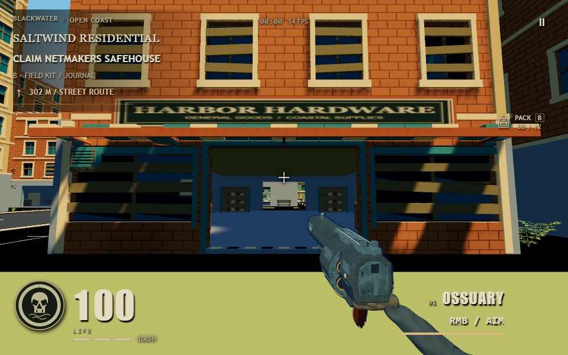
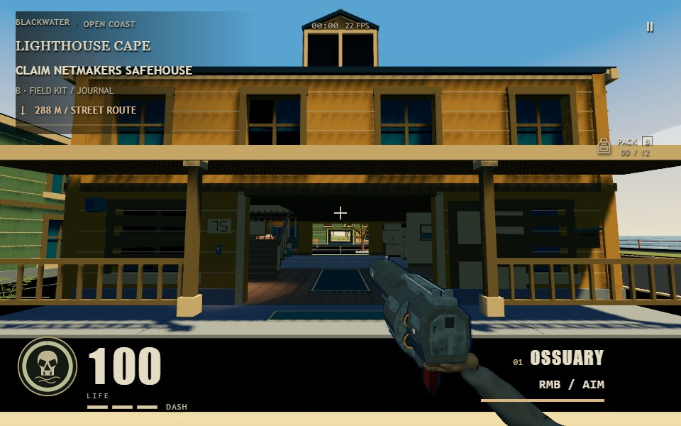
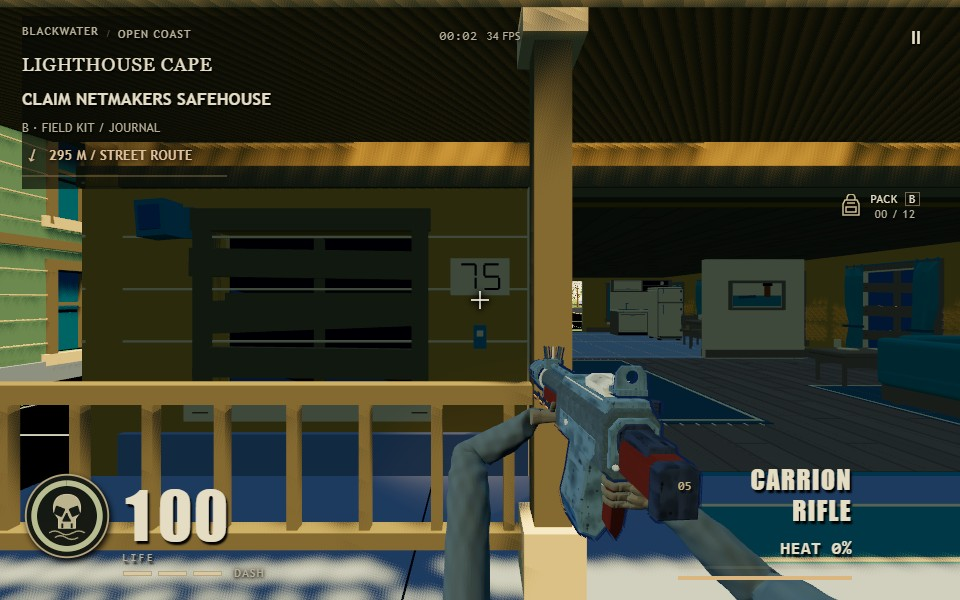
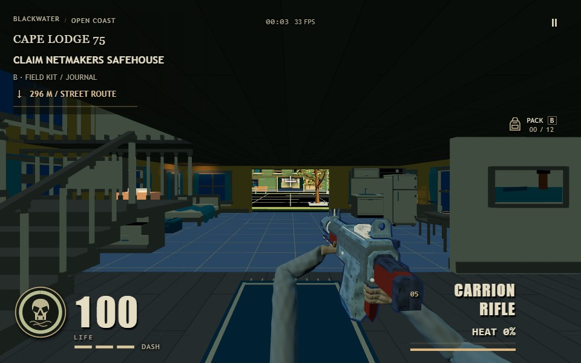
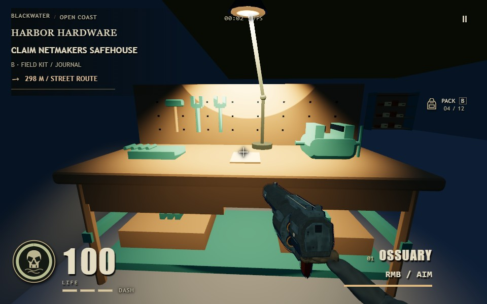

# Blackwater inspection 14

This iteration gives the existing playable entrances a clearer identity in the graphic-horror style. It keeps the ninety-four ground-floor openings, furniture, terrain, residents, vehicle and reviewed eight-weapon arm export intact.

Houses now have stencil-mesh address plaques taken from their real labels, doorbell hardware, flush bordered mats and porch slab joints. Shops have supported raised shutter housings, retained latch hardware and mounted notices. Hardware/workshop/warehouse/laundry thresholds have floor markings on the existing sill. Rear service doors receive small supported fittings. Apartment lobbies use a flat notice profile to preserve their tighter mesh budget. None of these markings is a raised obstacle or a new interaction promise.

The serialized entrance plan precedes geometry emission and uses the existing material-slot writer. Flat stencils and floor markings use two triangles each. There are no new materials, textures, lights or shadow maps. The shared ninety-four-model fixture retains 1,250 source draws; at 48 m chunks it uses 492 spatial batches, compared with the previous 484. The existing 2.1 million total-triangle cap, individual building caps and full four-metre door clearances remain enforced. The older batch-only 2.011 million cap was already below the measured accepted iteration-13 baseline (2,067,464); that fixture now uses the same 2.1 million cap as the all-interiors gate and allows at most eight extra spatial batches.

The existing HUD location now names the actual building after crossing into its main interior. Houses exclude the exterior porch from indoor bounds. The helper uses cached transforms and a cheap axis-aligned rejection before the exact local-bound check; it adds no per-frame planning or geometry work. Separate legacy room names and outdoor district labels retain priority in their respective spaces.

Native acceptance is recorded separately under output/playwright/blackwater-14. The owned verifier uses an immutable build, guarded background inputs and the existing full-quality native renderer. It covers Hardware's actual W doorway walk and fitting, new entrance close views, the cottage's actual W entry and both indoor HUD names. Initial viewpoints and crafting inventory are controlled. Four unused startup preparations are scoped out only in that QA browser, as in iteration 13. This does not establish full startup, sustained combat performance or additional enterable upper floors.

Verification: all 42 focused checks passed, including full ninety-four-model rendered portal rays, movement routes, geometry/resource ownership, address bounds, rotated/cached interior labels, the authored cottage, existing task lights, crafting, foliage and the pickup. No individual building or whole-coast geometry cap was raised. Native resource job 2567e1b9824848e382a51e9d25a1bf52 passed eight views, Hardware W entry and fitting, cottage W entry and actual indoor HUD names on NVIDIA/Turing WebGPU. Page/runtime/HTTP errors and native lock attempts were zero. The owned browser and temporary server closed. The final arm asset remained f4416246bccf7e784a2004bac4e49bae4de0098d0645074b2672f0ad06ed0b94. Start took 122,993 ms under shared resources with scoped preparations omitted; this is a capture receipt, not a readiness or gameplay-FPS claim.

A separate wider-framing followup, job 5984922aa94e4e2492b5f1531fae6c22, passed two actual native exterior views against the unchanged snapshot. Its scoped Start took 23,603 ms. It made no new input or performance claim; the native-v1 report remains the walking/fitting authority. Both browsers and temporary servers closed. Only the three owned runtime files were delivered, and all twenty-five checked native capture dependencies match canonical port 5200, including the final arm asset. The original tab and server were preserved. See live-delivery-binding.json and verification.json.

Later arm integration: the arm chat delivered its iteration-07 glove polish with export SHA256 41a7a22880c9cc6d8cd516b693874f775f2679af531734878b3d0692d0b38c3d (19,074,868 bytes). Source, dist and canonical port 5200 match it. All three world files remain unchanged and also match its newer immutable game-final-dist snapshot; see iteration07-arm-integration.json. That chat supplies latest-world native holds/body and corrected-clock motion evidence in first-person-parity/iteration-07/review.json. The world screenshots below retain the earlier f4416246 export they actually captured; they have not been relabelled as new glove footage. Equipment sockets, injury roots and fitting families retain the integration contract. Professional visual acceptance remains with the user.

