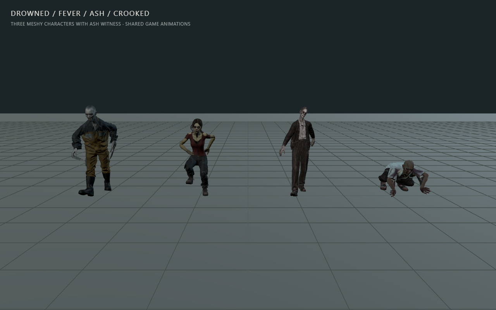

# Meshy zombie variations — October 4, 2026

Three new character bodies use the same ten-animation library as Ash Witness.
Generation uses the user's Meshy account configured in Desktop/Dogfight. All
tooling, models and game changes live in The Last Dead; Dogfight is read only.

| Character | Appearance and default motion |
| --- | --- |
| Drowned Dockworker | Bald, pale worker in ochre workwear and rubber boots; shambler. |
| Fever Runner | Gaunt woman with a bruised cadaver complexion, burgundy clothing and running shoes; runner. |
| Crooked Crawler | Hollow-eyed patient in a stained pale tunic, dark trousers and slippers; crawler. |



Meshy 7.1 generates approximately 20,000 triangles per character with PBR
textures. The runner's initial texture looked healthy; one additional Meshy
retexture pass corrected its complexion before rigging. The three mesh,
texture and rig jobs cost **115 Meshy credits** in total, including that
10-credit correction. No new provider animation jobs are used. Provider task
IDs and sanitized delivery receipts accompany each runtime GLB.
[Meshy generation](https://docs.meshy.ai/en/api/text-to-3d),
[rigging](https://docs.meshy.ai/en/api/rigging),
[retexturing](https://docs.meshy.ai/en/api/retexture), and
[pricing](https://docs.meshy.ai/en/api/pricing) were checked before submission.

The credential probe returned `MESHY_API_KEY=SET`. Keys are read only by offline
Node tooling; they are never included in a model, manifest or browser script.
Every paid submission has an exclusive durable journal. Explicit request
rejections and an interrupted local rig submission were reconciled before
retrying, so successful generations were not submitted twice. Original models,
PBR maps and task results are retained in
`.art-source/zombie-variants-meshy/<character>/`.

## Animation fit and delivery

`scripts/prepare-zombie-variant.py` fits the canonical v07 motions onto each
model's own skeleton and body proportions. The offline pipeline preserves
limb lengths, uses two-bone IK for hand/foot contacts, and adds weighted jaw and
grip controls plus the sockets required by the game's combat effects.
The original six motions and four runner/crawler loops retain their names and
timing, including the 0.375-second attack contact.

`scripts/pack-zombie-variants.mjs` retains geometry, skin weights, rig controls
and animation tracks. Base color is delivered as 2K WebP; normal/ORM maps use
1K lossless WebP. The original 2K PBR data and fitted uncompressed GLBs remain
in the preservation archive. Provider access and Blender are offline authoring
dependencies; the game still runs with Node and bundled assets alone.

The new Meshy bodies retain their original lower-face topology. Their weighted
jaw controls move the face, but this pass does not add the authored oral cavity,
teeth and tongue found in the original Ash Witness rig. The crawler's long,
narrow fingers are part of the generated mesh. All three have hand grip motion;
individual finger joints and general terrain foot IK are not added here.

## Game integration

The normal coastal population repeats dockworker, runner, Ash Witness and
crawler. Explicitly authored appearances win, and an injured runner retains
its body when locomotion changes to the existing injury crawl. Host snapshots
retain the appearance string.

The renderer loads each template once, warms its actual material/physics path,
and uses appearance-aware pools. Actors share source geometry/textures but own
their materials, mixer and skeleton. Counter attacks restore from each actor's
own bind template. Generated bodies retain their authored colored albedo atlases
under the existing Blackwater light bands, normals, alpha and combat cues. The
original Ash Witness keeps its grayscale semantic palette. This avoids losing
the new skin, tunic, workwear, trousers and boot colors in the game shader.
Diagnostics expose every appearance's load status, clip
names, errors and active instance count. A missing asset visibly falls back to
Ash Witness while the error remains in diagnostics.

## Verification

The packed asset suite passes **6/6 checks**, including exact paid-source mesh
positions, normals and UVs, ten complete clips, fixed limb lengths, weighted
jaw/grip movement, full skin bounds, running support/flight, crawler attack
transitions and the exact 0.375-second contact. Its measurements and final
digests are in `packed-runtime-validation.json`.

The current regression batch passes **96/96 checks** and the integration batch
passes **55/55 checks**. Logs are `output/zombie-variants-regression-tests.log`
and `output/zombie-variants-integration-tests.log`. The colored-atlas correction
also passes 33 focused style, appearance, integration and loading checks. The
production build passes; source and packaged GLBs have identical final digests.

The focused correction command is:

```powershell
node --test --test-isolation=none tests/blackwater-actor-style.test.mjs tests/blackwater-actor-integration.test.mjs tests/zombie-appearances.test.mjs tests/loading-preparation.test.mjs
```

Its 33-pass tool receipt is preserved in the chat. The subsequent diagnostic
addition also passed the 18-case subset excluding loading preparation.

`generation-receipt.json` records all ten successful provider tasks and their
actual `consumed_credits` values: **115 credits**. The live server receipt verifies
the final asset bytes and eight integration modules at `http://127.0.0.1:5200/`.

Final **source and production browser checks pass**:

- `output/playwright/zombie-variants/source-final/report.json`
- `output/playwright/zombie-variants/production-final/report.json`
- `output/playwright/zombie-variants/production-final/verification.json`

Both receipts parse the exact three delivered GLB digests and hash six served
runtime modules. All source/production hashes match. Each variant completes
8/11/6 attacks respectively in twelve simulated seconds, with planted contact
frames and the correct 0.375-second pose. Actual weighted jaw/grip deformation,
all six sockets, source-specific counter poses, full-skin clip bounds, crawler
rise/recovery and runner support/flight pass. Installed Chrome runs the native
WebGPU coastal game with eight natural residents: two of each new body and two
Ash Witnesses. All generated actors retain their authored colored-atlas mode.
The final run has zero console, page, HTTP or request failures. Desktop,
portrait, front-facing gameplay, hand/jaw and neutral lineup captures accompany
the reports. Visual review found coherent limbs and readable low crawler poses.

An earlier packaged run reported WebGPU device loss. Its diagnostic remains in
`output/playwright/zombie-variants/production/report.json`; a bounded retry in a
fresh native browser passes cleanly. The final fixture closes its studio browser
before launching native WebGPU QA. No asset or runtime changes were made for
that retry. The existing game tab and canonical server remain intact.

The final 24-actor studio sample measures 240 animation batches, including 757
crawler transition updates. Mean update time is **1.14 ms**, p95 **2.0 ms**, and
maximum **3.4 ms** on this machine. Studio rendering uses 27 calls and 499,018
triangles. Shared asset geometry buffers occupy 13,942,204 bytes; the ten shared
atlases have an estimated 102,061,397 decoded RGBA/mipmap bytes. These exclude
render targets, bone textures, driver allocation and rendering time. The heap
snapshot is 126,796,732 bytes without forced garbage collection. These are
bounded character measurements, not whole-game FPS or phone performance.

Refresh `http://127.0.0.1:5200/` and start a fresh run to load the new models and
population. Node and bundled assets are sufficient; authoring tools and provider
credentials are not needed during play.

## Workflow references

Applied the Three.js game director's narrow asset/integration route and its
focused phase delegation. Read the 3D generator skill, API notes and Three.js
integration reference; the user explicitly selected Meshy, so provider API
parameters and costs came from the official Meshy documentation above.
The rig worker applies procedural-animation guidance; the browser worker
applies QA/release references and checks actual weighted skin, textures,
motion and native game integration. There are no Tripo API calls, new world
graphics, UI or audio generation in this pass.
